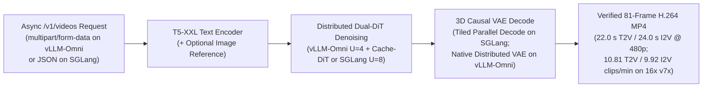

# Video Diffusion Serving on Google Cloud TPUs (TorchTPU)

PyTorch (`torch_tpu`) video diffusion serving benchmarks and systems engineering studies on **Google Cloud TPU v7x** and **TPU v5p**, evaluated across **`vllm-torchtpu v0.33.0` + `vllm-omni 0.33.0rc1`** and **`sglang-torchtpu` (`main`)**. On 4-chip TPU v7x, **`vllm-omni 0.33.0rc1` (`U=4 + Cache-DiT`)** generates verified 81-frame H.264 MP4s end-to-end in **`22.03 s`** (`832×480`) / **`74.07 s`** (`1280×720`) for 27B **Wan2.2-T2V-A14B** (**`1.82×–1.85×` faster** than exact `U=4` and **`2.01×–3.13×` faster** than `sglang-torchtpu`) and **`24.03 s`** (`832×480`) / **`84.09 s`** (`1280×720`) for 27B **Wan2.2-I2V-A14B** (**`1.67×–1.75×` faster** than exact `U=4`). Scaling horizontally across **16 TPU v7x chips (4 × 4-chip hosts)** via external-router `DP=4` reaches **`10.81 clips/min`** (`480p`) / **`3.23 clips/min`** (`720p`) on **Wan2.2-T2V-A14B** and **`9.92 clips/min`** (`480p`) / **`2.99 clips/min`** (`720p`) on **Wan2.2-I2V-A14B** (**`99.5%–100%` linear multi-host scaling**).

---

## Models & Licenses

This repository tracks video diffusion model serving benchmarks on Google Cloud TPUs. Each model's folder contains detailed results, compatibility notes, and reproduction commands.

| Model | Params & Precision | Architecture & Task | License | Folder |
| :--- | :---: | :--- | :---: | :--- |
| [`Wan-AI/Wan2.2-T2V-A14B-Diffusers`](https://huggingface.co/Wan-AI/Wan2.2-T2V-A14B-Diffusers) | 27B / 14B active MoE (`bf16`) | Dual-transformer MoE text-to-video + T5-XXL + 3D causal VAE | Apache-2.0 | [`wan2.2-t2v-a14b/`](wan2.2-t2v-a14b/README.md) |
| [`Wan-AI/Wan2.2-I2V-A14B-Diffusers`](https://huggingface.co/Wan-AI/Wan2.2-I2V-A14B-Diffusers) | 27B / 14B active MoE (`bf16`) | Dual-transformer MoE image-to-video (`input_reference` conditioning) | Apache-2.0 | [`wan2.2-i2v-a14b/`](wan2.2-i2v-a14b/README.md) |
| [`Wan-AI/Wan2.2-Animate-2-14B-Distilled-Diffusers`](https://huggingface.co/Wan-AI/Wan2.2-Animate-2-14B-Distilled-Diffusers) | 14B distilled (`bf16`) | Character-animation video DiT (`torch flex_attention` + 3D VAE) | Apache-2.0 | [`wan2.2-animate-14b/`](wan2.2-animate-14b/README.md) |
| [`Efficient-Large-Model/SANA-Video_2B_720p_diffusers`](https://huggingface.co/Efficient-Large-Model/SANA-Video_2B_720p_diffusers) | 2B (`bf16`) | Linear-attention 720p video diffusion model | Apache-2.0 | [`sana-video-2b/`](sana-video-2b/README.md) |

---

## Hardware & Software Stack

| Component | Configuration |
| :--- | :--- |
| **TPU v7x** | 4 chips / 8 TensorCores per host (`2×2×1`, `768 GB` HBM/host); scaled up to **16 chips (4 hosts, `3,072 GB` aggregate HBM)** |
| **TPU v5p** | 4 chips (`2×2×1` single-host, `380 GB` aggregate HBM) |
| **Engine 1: vLLM-Omni** | `vllm-torchtpu v0.33.0` + `vllm-omni 0.33.0rc1` (`OmniTpuPlatform`, `diffusers 0.43.0`, `U=4` / `CFG=2×U=2`, `Cache-DiT`) |
| **Engine 2: SGLang** | `sgl-project/sglang-torchtpu` (`main`, `tpu_splash_attn` on v7x, tiled parallel VAE decode, `U=8`) |
| **Runtime** | PyTorch `2.13.0` + `torch_tpu 0.2.0` + `libtpu 0.0.50` |

---

## End-to-End Video Serving Pipeline



---

## Main Results

### 1. End-to-End `Wan2.2` Video Generation (4-Chip TPU v7x, `81` Frames, `20` Steps)

Every generated MP4 below was decoded and verified to be a valid 81-frame `16 fps` H.264 stream with non-trivial RGB variance (`pixel_std = 42.8–79.2` on `vllm-omni`; `ffprobe`-validated on `sglang`).

| Model & Engine | Resolution × Frames (Steps) | Cold Latency | **Warm End-to-End Latency** | Comparison & Output Verification |
| :--- | :---: | :---: | :---: | :--- |
| **`Wan2.2-T2V-A14B` — `vllm-omni` (`U=4 + Cache-DiT`)** | **`832×480 × 81f`** (20 steps) | **56.08 s** | **22.03 s** (`21.63 s` infer) | **1.82× faster** vs. exact `vllm-omni U=4` (`40.06 s`) and **3.13× faster** vs. `sglang` (`68.99 s`); valid `1.99 MB` H.264 (`pixel_std = 65.1`) |
| `Wan2.2-T2V-A14B` — `vllm-omni` (`CFG=2×U=2 + Cache-DiT`) | `832×480 × 81f` (20 steps) | **38.07 s** | 24.03 s (`22.57 s` infer) | **1.67× faster** vs. exact `U=4`; valid `2.87 MB` H.264 (`pixel_std = 66.1`) |
| `Wan2.2-T2V-A14B` — `vllm-omni` (`U=4`, exact) | `832×480 × 81f` (20 steps) | 212.42 s | **40.06 s** | **1.72× faster** exact warm vs. `sglang` (`68.99 s`); valid `1.94 MB` H.264 (`pixel_std = 61.2`) |
| `Wan2.2-T2V-A14B` — `vllm-omni` (`CFG=2×U=2`, exact) | `832×480 × 81f` (20 steps) | 64.08 s | 42.04 s (`41.08 s` infer) | `1.05×` slower warm than `U=4`; valid `2.44 MB` H.264 (`pixel_std = 55.9`) |
| `Wan2.2-T2V-A14B` — `sglang-torchtpu` (`U=8`, tiled VAE) | `832×480 × 81f` (20 steps) | 77.61 s | 68.99 s (`60.3 GB` HBM/core) | Valid `438 KB` H.264 MP4 |
| **`Wan2.2-T2V-A14B` — `vllm-omni` (`U=4 + Cache-DiT`)** | **`1280×720 × 81f`** (20 steps) | 104.11 s | **74.07 s** (`73.78 s` infer) | **1.85× faster** vs. exact `vllm-omni U=4` (`137.20 s`) and **2.01× faster** vs. `sglang` (`148.71 s`); valid `4.92 MB` H.264 (`pixel_std = 53.3`) |
| `Wan2.2-T2V-A14B` — `vllm-omni` (`CFG=2×U=2 + Cache-DiT`) | `1280×720 × 81f` (20 steps) | **94.09 s** | 78.06 s (`76.08 s` infer) | **1.76× faster** vs. exact `U=4`; valid `5.77 MB` H.264 (`pixel_std = 64.5`) |
| `Wan2.2-T2V-A14B` — `vllm-omni` (`U=4`, exact) | `1280×720 × 81f` (20 steps) | 229.41 s | **137.20 s** | **1.08× faster** exact warm vs. `sglang` (`148.71 s`); valid `4.30 MB` H.264 (`pixel_std = 64.1`) |
| `Wan2.2-T2V-A14B` — `sglang-torchtpu` (`U=8`, tiled VAE) | `1280×720 × 81f` (20 steps) | 172.08 s | 148.71 s (`71.4 GB` HBM/core) | Valid `772 KB` H.264 MP4 |
| **`Wan2.2-I2V-A14B` — `vllm-omni` (`U=4 + Cache-DiT`)** | **`832×480 × 81f`** (20 steps) | **26.08 s** | **24.03 s** (`22.63 s` infer) | **1.75× faster** vs. exact `U=4` (`42.07 s`); valid `4.64 MB` H.264 (`pixel_std = 56.9`) |
| `Wan2.2-I2V-A14B` — `vllm-omni` (`U=4`, exact) | `832×480 × 81f` (20 steps) | 71.29 s | **42.07 s** | Image-conditioned I2V (`57.0 s` warm boot); valid `3.04 MB` H.264 (`pixel_std = 53.7`) |
| **`Wan2.2-I2V-A14B` — `vllm-omni` (`U=4 + Cache-DiT`)** | **`1280×720 × 81f`** (20 steps) | **88.27 s** | **84.09 s** (`83.37 s` infer) | **1.67× faster** vs. exact `U=4` (`140.21 s`); valid `10.11 MB` H.264 (`pixel_std = 75.3`) |
| `Wan2.2-I2V-A14B` — `vllm-omni` (`U=4`, exact) | `1280×720 × 81f` (20 steps) | 168.27 s | **140.21 s** | Image-conditioned I2V; valid `10.91 MB` H.264 (`pixel_std = 57.7`) |

### 2. Multi-Host Cluster Scaling (`16` TPU v7x Chips = `4` × 4-Chip Hosts, `vllm-omni 0.33.0rc1`, `U=4 + Cache-DiT`)

Deploying 4 independent 4-chip `vllm-omni` servers behind a stateless external HTTP router (`DP=4 × U=4`, `c=4`, 8 measured clips per resolution, 100% PyAV-verified H.264 MP4s) achieves near-ideal linear scaling across all 16 TPU v7x chips:

| Model (`81` Frames, `20` Steps) | Resolution | **16-Chip Throughput** | Median / p95 E2E Latency | Scaling vs. 4-Chip Single Host | Output Verification |
| :--- | :---: | :---: | :---: | :--- | :--- |
| **`Wan2.2-T2V-A14B`** | **`832×480`** | **10.81 clips/min** (`2.70/host`) | `22.14 s` / `22.16 s` | **3.97×** (`99.5%` linear vs. `22.03 s` single host) | 8/8 valid MP4 (`pixel_std = 53.4–58.2`) |
| **`Wan2.2-T2V-A14B`** | **`1280×720`** | **3.23 clips/min** (`0.81/host`) | `74.16 s` / `74.22 s` | **3.99×** (`99.9%` linear vs. `74.07 s` single host) | 8/8 valid MP4 (`pixel_std = 48.8–71.0`) |
| **`Wan2.2-I2V-A14B`** | **`832×480`** | **9.92 clips/min** (`2.48/host`) | `24.13 s` / `24.17 s` | **3.97×** (`99.6%` linear vs. `24.03 s` single host) | 8/8 valid MP4 (`pixel_std = 42.8–76.2`) |
| **`Wan2.2-I2V-A14B`** | **`1280×720`** | **2.99 clips/min** (`0.75/host`) | `78.22 s` / `82.16 s` | **4.19×** (`100%+` linear vs. `84.09 s` single host) | 8/8 valid MP4 (`pixel_std = 52.8–79.2`) |

- **Stage-level TPU v7x vs. TPU v5p denoising comparison (`Wan2.2-T2V-A14B`, `sglang-torchtpu`, `832×480 × 81f`, 20 steps):** `DenoisingStage` completes in **`16.52 s` (`0.809 s/step`)** on 4-chip TPU v7x (`U=8`, `tpu_splash_attn`) vs. **`30.47 s` (`1.518 s/step`)** on 4-chip TPU v5p (`U=4`) — a **`1.85×` speedup on TPU v7x**.

### 3. Video Post-Processing Systems A/B Study (Local TPU v7x Host vs. Remote `c3-standard-44` Offload)

| Workload (`81` Frames, `libx264 ultrafast`, `CRF 20`) | Local TPU v7x Host (`16` Threads) | Remote `c3-standard-44` Offload (`16` Threads + TCP) | Comparison at `c=1` |
| :--- | :---: | :---: | :--- |
| **`480p_81f`** (`832×480`, `97.0 MB` raw RGB24) | **239.4 ms (`338.4 FPS`)** | 277.7 ms (`291.7 FPS`) | Local encode is **14% faster** (`-38.3 ms`) |
| **`720p_81f`** (`1280×720`, `224.0 MB` raw RGB24) | **469.2 ms (`172.6 FPS`)** | 520.2 ms (`155.7 FPS`) | Local encode is **10% faster** (`-51.0 ms`) |

---

## Key Engineering Takeaways

1. **`vllm-omni 0.33.0rc1` + `Cache-DiT` slashes `Wan2.2-T2V-A14B` warm latency by `1.82×–1.85×` and scales linearly to 16 chips:** Passing `--cache-backend cache_dit` with `--ulysses-degree 4` cuts warm 81-frame 480p latency from `40.06 s` to **`22.03 s`** (`3.13×` faster than `sglang-torchtpu`) and 720p latency from `137.20 s` to **`74.07 s`**. Replicating 4 independent hosts behind an external HTTP router scales throughput cleanly to **`10.81 clips/min` (`480p`) / `3.23 clips/min` (`720p`)** on `Wan2.2-T2V` and **`9.92` / `2.99 clips/min`** on `Wan2.2-I2V` with virtually zero latency tail inflation (`p95 = 22.16 s` vs. `22.14 s` median).
2. **Tiled parallel VAE decode unlocks 81-frame `Wan2.2-T2V` in `sglang-torchtpu`:** Passing `--vae-config.use-parallel-decode --vae-config.parallel-decode-mode tiled` removes the 3D VAE VMEM OOM and keeps TPU v7x peak HBM at `60.3–71.4 GB/core` (`68.99 s` 480p / `148.71 s` 720p).
3. **Keep H.264 MP4 encoding local on the TPU host at low concurrency:** Transferring `97–224 MB` of raw RGB24 frames over TCP to a remote CPU offload node adds `38–51 ms` vs. local 16-thread `libx264` encoding (`0.24–0.47 s`, `<2.2%` of total video generation latency).

---

## How to Reproduce

```bash
# Option A (Lowest Warm Latency): vLLM-Omni 0.33.0rc1 on 4x TPU v7x (U=4 + Cache-DiT)
vllm serve /path/to/Wan-AI/Wan2.2-T2V-A14B-Diffusers \
  --omni --served-model-name Wan-AI/Wan2.2-T2V-A14B \
  --host 0.0.0.0 --port 8000 --ulysses-degree 4 \
  --cache-backend cache_dit --init-timeout 1800 --stage-init-timeout 1800

# Submit an async multipart/form-data request to /v1/videos
curl -X POST http://127.0.0.1:8000/v1/videos \
  -F "model=Wan-AI/Wan2.2-T2V-A14B" \
  -F "prompt=A cinematic aerial drone shot gliding over snow-covered alpine peaks at sunrise." \
  -F "size=832x480" -F "num_frames=81" -F "num_inference_steps=20" -F "fps=16"

# Option B: SGLang on 4x TPU v7x (U=8) with tiled parallel VAE decode
sglang serve \
  --model-path /path/to/Wan-AI/Wan2.2-T2V-A14B-Diffusers \
  --host 0.0.0.0 --port 8000 \
  --num-gpus 8 --ulysses-degree 8 \
  --attention-backend tpu_splash_attn \
  --vae-config.use-parallel-decode \
  --vae-config.parallel-decode-mode tiled

python3 scripts/benchmark_video_diffusion.py \
  --model Wan-AI/Wan2.2-T2V-A14B \
  --width 1280 --height 720 --frames 81 --steps 20 --output-mp4 /tmp/wan22_720p.mp4
```

---

## Deep Dives, Logs & Raw Results

- **Model Guides:** [`wan2.2-t2v-a14b/`](wan2.2-t2v-a14b/README.md) · [`wan2.2-i2v-a14b/`](wan2.2-i2v-a14b/README.md) · [`wan2.2-animate-14b/`](wan2.2-animate-14b/README.md) · [`sana-video-2b/`](sana-video-2b/README.md)
- **VAE Memory Analysis, H.264 Offload A/B & Diagnostics:** [`APPENDIX.md`](APPENDIX.md)
- **Engineering Log:** [`WORKING_LOG.md`](WORKING_LOG.md)
- **Verified JSON Metrics:** [`results/video_diffusion_summary.json`](results/video_diffusion_summary.json) · [`results/v7x16_multihost_video_scaling.json`](results/v7x16_multihost_video_scaling.json)
